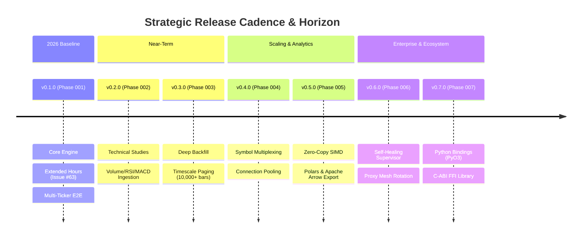

# 🗺️ Master Strategic Roadmap: `tradingview-streamer`

Master execution roadmap for `tradingview-streamer`. Designed to establish the definitive, high-performance async Rust standard for financial market data ingestion, comparable to the ubiquity of `yfinance` in Python.

All initiatives follow a **Modular Numbered Phase Architecture** located in [`docs/phases/`](docs/phases/).

---

## 🧭 Executive Horizon & Vision

---

## 📊 Phase Matrix Dashboard

| Phase ID | Title | Target Milestone | Status | Key Deliverable |
|:---:|:---|:---:|:---:|:---|
| **[Phase 001](docs/phases/001_core_streamer_and_extended_hours.md)** | Core WebSocket Engine & Extended Trading Hours | `v0.1.0` | `COMPLETED` | Fix for `mnwato/tradingview-scraper#63` via `SessionType::Extended`. |
| **[Phase 002](docs/phases/002_technical_indicators_and_studies.md)** | Technical Indicators & Built-in Studies Ingestion | `v0.2.0` | `PLANNED` | Automated `create_study` RPC and multi-indicator streaming (`du`). |
| **[Phase 003](docs/phases/003_deep_historical_backfill_and_paging.md)** | Deep Historical Backfill & Timescale Paging | `v0.3.0` | `PLANNED` | Automated backward paging (`request_more_data`) for >10,000 bars. |
| **[Phase 004](docs/phases/004_multi_symbol_multiplexing_and_pool.md)** | Multi-Symbol Multiplexing & Connection Pooling | `v0.4.0` | `BACKLOG` | Single-socket multi-ticker dispatch and dynamic subscription pool. |
| **[Phase 005](docs/phases/005_simd_json_and_polars_arrow_export.md)** | Zero-Copy SIMD Deserialization & Polars/Arrow | `v0.5.0` | `BACKLOG` | Resolution of `DEBT-01` via SIMD JSON and Apache Arrow export. |
| **[Phase 006](docs/phases/006_resilient_supervisor_and_proxy_mesh.md)** | Resilient Supervisor & Proxy Mesh Rotation | `v0.6.0` | `BACKLOG` | Resolution of `RISK-01` via exponential jitter and SOCKS5 proxy pool. |
| **[Phase 007](docs/phases/007_python_pyo3_and_c_ffi_bindings.md)** | Python (PyO3) & C-ABI Foreign Function Interface | `v0.7.0` | `BACKLOG` | `pip install tradingview-streamer` native Python package. |

---

## ⚙️ Phase Execution Workflow for Contributors & AI Agents

To ensure strict engineering governance and prevent architectural drift:
1. **Selecting a Phase**: Pick an item with status `PLANNED` or `BACKLOG`. Read its specification in `docs/phases/<NNN>_*.md`.
2. **Branching & Conventions**: Create branch `feat/phase-<NNN>-<slug>`. All commits must use Conventional Commits (`feat:`, `fix:`).
3. **The Gauntlet Verification**:
   - Every phase MUST satisfy its declared Acceptance Criteria (`AC-01`, `AC-02`, ...).
   - All tests must pass: `cargo test --all-targets`.
   - Maintain zero production mocks: `detect-mocks .`.
   - Update architecture docs: `arc42-lint docs/architecture`.
4. **Graduation & Release**:
   - When merged into `main`, GitHub Actions invokes `release-plz` to generate changelogs, bump SemVer, and publish releases automatically.

---

## 🔗 Related Documentation
- [README.md](README.md) - Crate overview, installation, and quickstart examples.
- [AGENTS.md](AGENTS.md) - Autonomous coding agent guidelines and interface contracts.
- [GEMINI.md](GEMINI.md) - Repository architecture rules and verification gauntlet.
- [docs/architecture/](docs/architecture/) - arc42 international standard architecture documentation.
