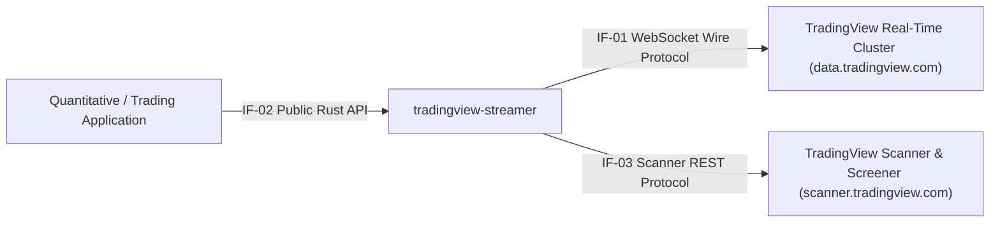

# 03 Context and Scope

> [!INFO] **Architecture Provenance & Freshness**
> - **Verified Commit**: `1a57c8d` (branch: `main`)
> - **Verified Timestamp**: `2026-10-31T08:44:44+07:00`
> - **Tracked Paths**: `src/`, `tests/`, `Cargo.toml`
> - **Drift Status**: `verified`

## 3.1 Business Context
`tradingview-streamer` sits between external quantitative trading / analytics applications and TradingView's distributed infrastructure (WebSocket streaming clusters and Scanner HTTP APIs).

## 3.2 External Interfaces

| Interface ID | Interface Name | Protocol / Mechanism | Target System / Consumer | Description |
|:---:|:---|:---|:---|:---|
| `IF-01` | TradingView Wire Protocol | WSS / Socket.IO framing (`~m~<len>~m~`) | `data.tradingview.com` | Bi-directional WebSocket transport transmitting session initialization (`cs_...`, `qs_...`), symbol requests, study creation, and receiving timescale/quote updates. |
| `IF-02` | Public Streamer API | Rust Public Traits & Structs (`TvStreamer`, `Ticker`) | Downstream Rust Applications | Ergonomic builder, 1-line facade, and async streams yielding strongly typed [`OhlcvCandle`] and quote updates. |
| `IF-03` | TradingView Scanner REST API | HTTPS JSON POST / GET | `scanner.tradingview.com` | High-throughput multi-market screener, market movers (pre/post-market leaders), technical indicator ratings, and company overview endpoints. |

## 3.3 Technical Context
The library encapsulates TLS handshake verification, origin header validation required by TradingView ingress proxies, keep-alive heartbeat ping/pong sequences, type-safe scanner filter serialization, and zero-allocation JSON streaming.
