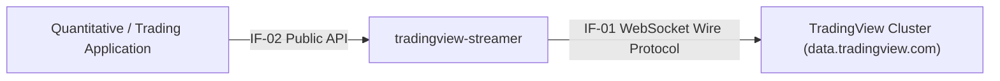

# 03 Context and Scope

> [!INFO] **Architecture Provenance & Freshness**
> - **Verified Commit**: `b607430` (branch: `main`)
> - **Verified Timestamp**: `2026-10-30T18:45:58+07:00`
> - **Tracked Paths**: `src/`, `tests/`, `Cargo.toml`
> - **Drift Status**: `verified`

## 3.1 Business Context
`tradingview-streamer` sits between external quantitative trading / analytics applications and TradingView's WebSocket cluster.

## 3.2 External Interfaces

| Interface ID | Interface Name | Protocol / Mechanism | Target System / Consumer | Description |
|:---:|:---|:---|:---|:---|
| `IF-01` | TradingView Wire Protocol | WSS / Socket.IO framing (`~m~<len>~m~`) | `data.tradingview.com` | Bi-directional WebSocket transport transmitting session initialization, symbol requests, and receiving candle timescale updates. |
| `IF-02` | Public Streamer API | Rust Public Traits & Structs (`TvStreamer`) | Downstream Rust Applications | Ergonomic builder and async channel receiver yielding strongly typed [`OhlcvCandle`] events. |

## 3.3 Technical Context
The library encapsulates TLS handshake verification, origin header spoofing required by TradingView firewalls, keep-alive heartbeat ping/pong sequences, and JSON serialization.
