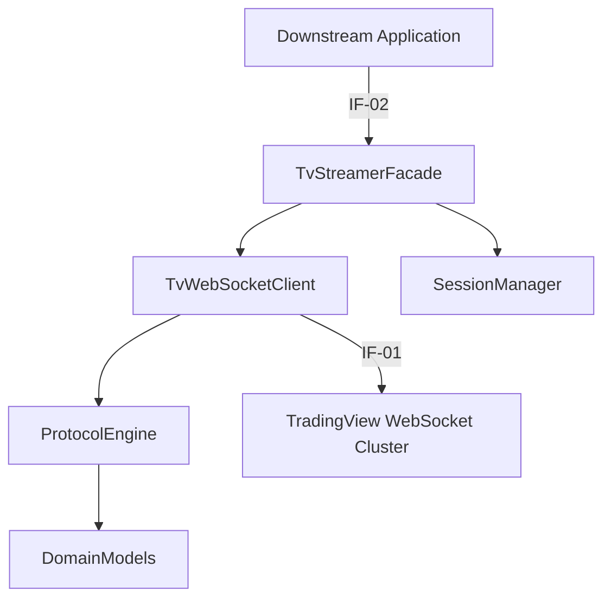

# 05 Building Block View

> [!INFO] **Architecture Provenance & Freshness**
> - **Verified Commit**: `037ee86` (branch: `main`)
> - **Verified Timestamp**: `2026-10-30T18:45:58+07:00`
> - **Tracked Paths**: `src/`, `tests/`, `Cargo.toml`
> - **Drift Status**: `verified`

## 5.1 Level 1 - Whitebox Overall System

### Contained Building Blocks

| Building Block Name | Source Location | Responsibility | Interfaces |
|:---|:---|:---|:---|
| TvStreamerFacade | `src/streamer.rs` | Provides ergonomic builder API, one-shot candle batch fetching, and channel-based streaming. | Implements `IF-02` |
| TvWebSocketClient | `src/client.rs` | Manages Tokio WebSocket connections, HTTP header injection, background loops, and heartbeats. | Consumes `IF-01` |
| ProtocolEngine | `src/protocol/` | Encodes outbound JSON RPC commands, parses `~m~` framing, and extracts candle timescale updates. | Internal |
| SessionManager | `src/session.rs` | Generates 12-char randomized chart (`cs_...`) and quote (`qs_...`) session tokens. | Internal |
| DomainModels | `src/types.rs` | Defines strongly typed data structures (`SessionType`, `Timeframe`, `Symbol`, `OhlcvCandle`). | Internal |

## 5.2 Level 2 - Core Subsystems

### ProtocolEngine Decomposition
- `src/protocol/framing.rs`: Handles raw `~m~<len>~m~` packaging and heartbeat extraction.
- `src/protocol/messages.rs`: Assembles `resolve_symbol` with `"session": "extended"` (Issue #63).
- `src/protocol/parser.rs`: Extracts `timescale_update`, `du`, and `qsd` packets into domain structs.
