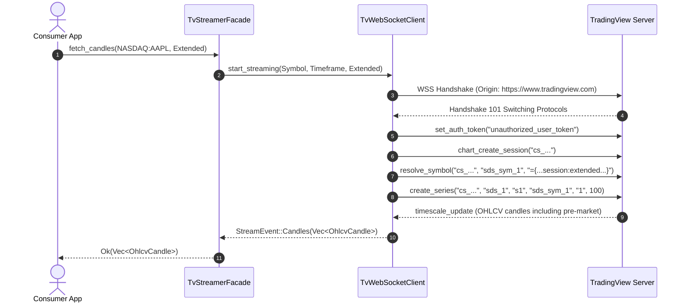
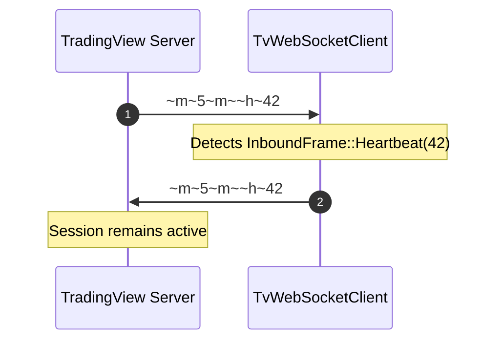

# 06 Runtime View

> [!INFO] **Architecture Provenance & Freshness**
> - **Verified Commit**: `d7b3d39` (branch: `main`)
> - **Verified Timestamp**: `2026-10-30T18:45:58+07:00`
> - **Tracked Paths**: `src/`, `tests/`, `Cargo.toml`
> - **Drift Status**: `verified`

## 6.1 Scenario 1 - Extended Trading Hours (ETH) Stream Ingestion

## 6.2 Scenario 2 - Automated Heartbeat Keep-Alive Loop

