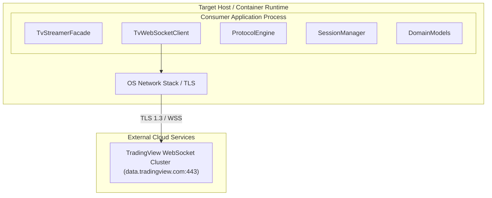

# 07 Deployment View

> [!INFO] **Architecture Provenance & Freshness**
> - **Verified Commit**: `d7b3d39` (branch: `main`)
> - **Verified Timestamp**: `2026-10-30T18:45:58+07:00`
> - **Tracked Paths**: `src/`, `tests/`, `Cargo.toml`
> - **Drift Status**: `verified`

## 7.1 Deployment Architecture
`tradingview-streamer` is distributed as a reusable Rust library crate (`Cargo.toml`) that compiles statically into consumer binaries, CLI daemons, or containerized microservices.

## 7.2 Building Block Deployment Mapping

| Building Block Name | Deployment Context | Resource Footprint |
|:---|:---|:---|
| TvStreamerFacade | Statically linked in host process thread. | Zero idle memory, stack-allocated builder. |
| TvWebSocketClient | Background Tokio asynchronous task. | Single TCP socket descriptor, <2MB RAM buffer. |
| ProtocolEngine | Inline compiled code within Tokio worker threads. | Ephemeral heap allocations for JSON frames. |
| SessionManager | Local random generator initialized on demand. | Minimal stack footprint. |
| DomainModels | Strongly typed Rust structs passed across async channels. | Zero-copy references where possible. |
