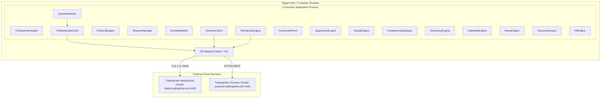

# 07 Deployment View

> [!INFO] **Architecture Provenance & Freshness**
> - **Verified Commit**: `c6038cb` (branch: `main`)
> - **Verified Timestamp**: `2026-10-30T22:55:29.431514+07:00`
> - **Tracked Paths**: `src/`, `tests/`, `Cargo.toml`
> - **Drift Status**: `verified`

## 7.1 Deployment Architecture
`tradingview-streamer` is distributed as a reusable Rust library crate (`Cargo.toml`) that compiles statically into consumer binaries, CLI daemons, or containerized microservices.

## 7.2 Building Block Deployment Mapping

| Building Block Name | Deployment Context | Resource Footprint |
|:---|:---|:---|
| TvStreamerFacade | Statically linked in host process thread. | Zero idle memory, stack-allocated builder. |
| TvWebSocketClient | Background Tokio asynchronous task. | Single TCP socket descriptor, <2MB RAM buffer. |
| ProtocolEngine | Inline compiled code within Tokio worker threads. | Ephemeral heap allocations for JSON frames. |
| SessionManager | Local random generator initialized on demand. | Minimal stack footprint. |
| DomainModels | Strongly typed Rust structs passed across async channels. | Zero-copy references where possible. |
| ScannerClient | Async HTTP client with connection pool. | Reused HTTP/1.1 or HTTP/2 keep-alive socket. |
| QuoteStreamer | Stream demultiplexer running on WebSocket task. | Minimal event dispatch overhead. |
| TechnicalsEngine | Query mapper calling ScannerClient. | Stateless transformation layer. |
| ConnectionPool | Managed socket pool balancing subscriptions across workers. | Adaptive WebSocket connections (<5MB RAM). |
| SupervisorEngine | Autonomous supervisor actor with backoff and circuit breaker. | Zero idle cost, lightweight state machine. |
| SocialEngine | HTTP scraper fetching ideas and Minds micro-posts. | Ephemeral REST requests via connection pool. |
| FundamentalsEngine | HTTP client retrieving valuation and financial statement ratios. | Ephemeral REST requests via connection pool. |
| DiscoveryEngine | Cross-exchange scanner resolving venues and arbitrage spreads. | Fast REST queries (<200ms latency). |
| CalendarEngine | Corporate calendar query client for dividends and earnings. | Low-frequency REST polling (<1MB RAM). |
| NewsEngine | Market news headlines stream with source wires. | Low-memory JSON parsing and event dispatch. |
| ColumnarExport | Structure-of-Arrays columnar layout and CSV exporter. | Contiguous memory allocation, cache-aligned. |
| FfiEngine | C-ABI foreign function interface statically exported in cdylib/rlib. | Zero runtime overhead, direct C calling convention. |
