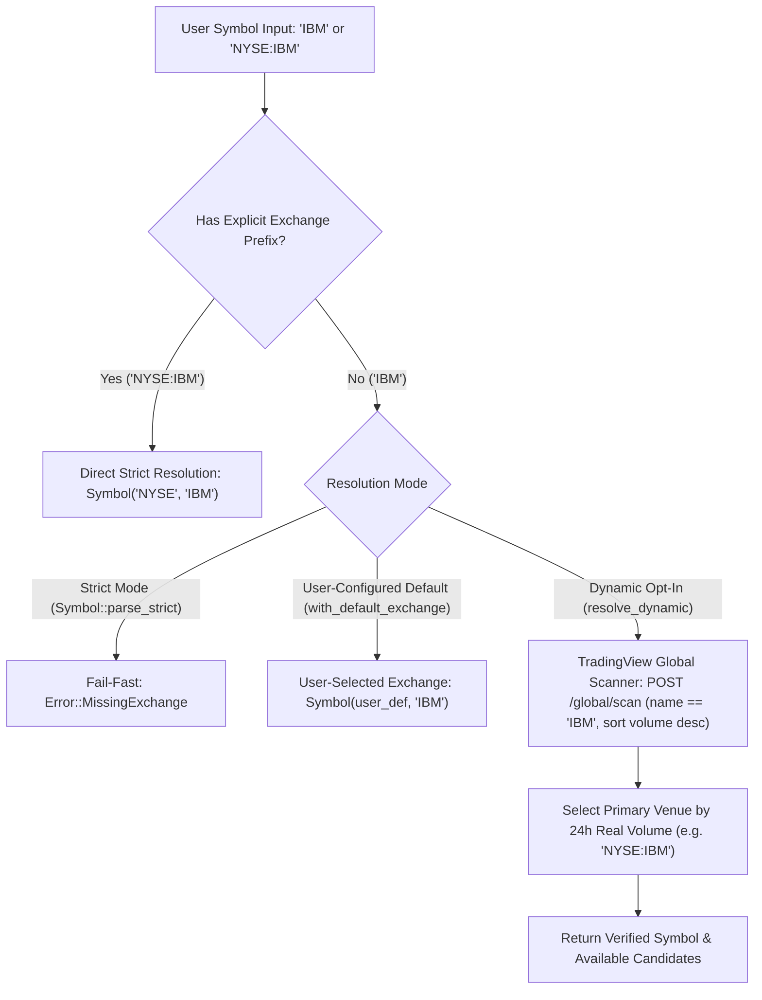

# Phase 017: Dynamic Venue Disambiguation & Strict Exchange Resolution

> [!INFO] **Phase Metadata**
> - **Phase ID**: `017`
> - **Title**: Dynamic Venue Disambiguation & Strict Exchange Resolution
> - **Status**: `COMPLETED`
> - **Target Milestone**: `v0.17.0`
> - **Constraint Alignment**: `CON-08` (Venue Disambiguation & Zero Silent Exchange Assumption)
> - **Architecture Decision**: `ADR-04` (Explicit Venue Specification & Dynamic Scanner Disambiguation)

---

## 1. Problem Statement & Motivation

In previous iterations, convenience symbol parsing relied on a heuristic `Symbol::smart_parse` that defaulted un-prefixed tickers (e.g. `"IBM"`, `"AAPL"`, `"BTCUSD"`) using hardcoded branch rules (e.g. crypto pairs -> `"BINANCE"`, else -> `"NASDAQ"`).

In professional financial data engineering and algorithmic trading, **silent hardcoded exchange guessing is hazardous**:
1. **Exchange Inaccuracy**: Many global equities (e.g. `IBM`, `TSM`, `BABA`) trade on `NYSE`, not `NASDAQ`. Defaulting to `NASDAQ:IBM` yields empty news (`{"items":[]}`), zero technical indicator rows (`{"totalCount":0}`), and broken chart series.
2. **Multi-Venue Ambiguity**: High-liquidity assets like `BTCUSD` trade on over a dozen distinct venues (`COINBASE:BTCUSD`, `KRAKEN:BTCUSD`, `BITSTAMP:BTCUSD`, `CME_MINI:BTC1!`) with varying spreads, order book depths, and funding rates.
3. **Consumer Sovereignty**: Data consumers must always possess explicit control over their data source and execution venue. The library must never secretly choose an exchange behind the developer's back.

Per architectural constraint `CON-08` and decision `ADR-04`, all silent exchange assumptions are strictly eliminated.

---

## 2. Technical Architecture & Invariant Guarantees



---

## 3. Deliverables & Module Breakdown

| Module | Location | Responsibility |
|:---|:---|:---|
| **Error Types** | `src/error.rs` | Add `Error::MissingExchange` and `Error::AmbiguousSymbol` with descriptive actionable remediation messages. |
| **Strict & Configurable Symbol** | `src/types.rs` | Remove hardcoded `"NASDAQ"` guessing. Provide `Symbol::parse_strict`, `Symbol::parse_with_default`, and `Symbol::resolve_dynamic`. |
| **Scanner Venue Resolver** | `src/discovery/client.rs` | Implement `resolve_primary_venue` and `discover_venues_exact` using TradingView's Global Scanner volume ranking. |
| **Ergonomic Ticker Disambiguation** | `src/ticker.rs` | Add `Ticker::new_strict`, `Ticker::new_with_default_exchange`, `Ticker::resolve_dynamic`, and dynamic resolution fallback. |
| **Verification Suite** | `tests/test_venue_disambiguation.rs` | Hermetic and live verification of strict errors, default overrides, and dynamic resolution for `IBM`, `BTCUSD`, and `BBCA`. |

---

## 4. Acceptance Criteria

- [x] **`AC-01` (Strict Parsing Invariant)**: `Symbol::parse_strict("IBM")` fails with `Error::MissingExchange`, while `"NYSE:IBM"` succeeds.
- [x] **`AC-02` (User Default Override)**: `Symbol::parse_with_default("IBM", "NYSE")` and `Ticker::new_with_default_exchange("IBM", "NYSE")` resolve to `NYSE:IBM` without network overhead.
- [x] **`AC-03` (Dynamic Volume Resolution)**: `DiscoveryClient::resolve_primary_venue("IBM").await` dynamically discovers `NYSE:IBM` via live volume ranking (not NASDAQ).
- [x] **`AC-04` (Multi-Venue Discovery)**: `Ticker::new("IBM").venues().await` returns all global listings (`NYSE:IBM`, `TSX:IBM`, etc.) enabling explicit venue comparison.
- [x] **`AC-05` (Pre-Flight Gauntlet)**: 100% test pass rate, all source files `< 350 lines`, zero production mocks, and `arc42-lint` fresh.

---

## 5. Verification Command

```bash
cargo test --test test_venue_disambiguation -- --nocapture
bash scripts/release-check.sh
```
