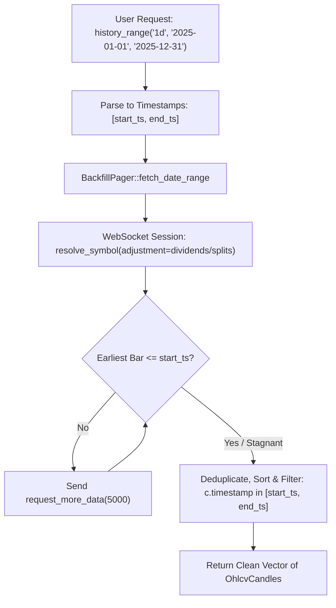

# Phase 018: Total Return Dividend Adjustment & Date-Range Ingestion

> [!INFO] **Phase Metadata**
> - **Phase ID**: `018`
> - **Title**: Total Return Dividend Adjustment & Date-Range Ingestion (`yfinance` Parity Phase 1)
> - **Status**: `COMPLETED`
> - **Target Milestone**: `v0.18.0`
> - **Upstream Parity**: Resolves `mnwato/tradingview-scraper#57` (Dividend-Adjusted Data), `#50` (Date Range Support), `#48` (Historical Date Range).

---

## 1. Problem Statement & Motivation

1. **Total Return & Dividend Cliff Drops (Issue #57)**:
   In quantitative backtesting, utilizing raw or split-only prices produces sharp downward price gaps on ex-dividend dates. Traders and institutional researchers require **Total Return / Dividend-Adjusted OHLCV** (equivalent to `yfinance.download(..., auto_adjust=True)`) to preserve continuous returns and accurate CAGR/Sharpe ratios.
   
2. **Calendar Date-Range & Period Shorthands (Issue #50 & #48)**:
   Developers accustomed to Python's `yfinance` expect date-bounded queries:
   ```python
   yf.download("AAPL", start="2025-01-01", end="2025-12-31")
   yf.Ticker("AAPL").history(period="1y")
   ```
   Our existing streamer only accepts candle counts (`count: u32`). A high-level date-range engine that automatically pages backwards (`request_more_data`) until the requested `start_date` is satisfied is essential for frictionless quantitative workflows.

---

## 2. Technical Architecture & Invariants



---

## 3. Deliverables & Module Breakdown

| Module | Location | Responsibility |
|:---|:---|:---|
| **Adjustment & Date Types** | `src/types.rs` | Introduce `PriceAdjustment` (`Splits`, `Dividends`, `None`), `DateRange`, and `Period` (`1d`, `1mo`, `1y`, `ytd`, `max`). |
| **Wire RPC Adjustment** | `src/protocol/messages.rs` | Update `build_symbol_spec` and `resolve_symbol` to accept type-safe `PriceAdjustment`. |
| **Client & Streamer Builder** | `src/client.rs`, `src/streamer.rs` | Thread `PriceAdjustment` through connection handshake, session initialization, and `TvStreamerBuilder`. |
| **Date-Range Backfill Pager** | `src/backfill.rs` | Implement `fetch_date_range` with automated timescale paging until `start_ts` is reached. |
| **Ergonomic Ticker Interface** | `src/ticker.rs` | Add `history_adjusted`, `history_range`, `history_range_adjusted`, and `history_period`. |
| **Top-Level 1-Liners** | `src/lib.rs` | Add `download_range`, `download_period`, and `download_adjusted`. |
| **Verification Suite** | `tests/test_yfinance_parity.rs` | Hermetic and live verification of dividend adjustment and calendar date-range queries. |

---

## 4. Acceptance Criteria

- [x] **`AC-01` (Type-Safe Price Adjustment)**: `PriceAdjustment::Dividends` serializes to wire `"adjustment": "dividends"`, `Splits` to `"splits"`, and `None` to `"none"`.
- [x] **`AC-02` (Period Parsing Parity)**: `Period::from_str` correctly parses `"1d"`, `"5d"`, `"1mo"`, `"3mo"`, `"6mo"`, `"1y"`, `"2y"`, `"ytd"`, `"max"`.
- [x] **`AC-03` (DateRange Parsing & Validation)**: `DateRange::parse_dates("2025-01-01", "2025-06-30")` produces valid epoch second timestamps where `start <= end`.
- [x] **`AC-04` (Date-Range Backward Paging)**: `BackfillPager::fetch_date_range` retrieves candles and trims precisely to the requested start and end timestamps.
- [x] **`AC-05` (Pre-Flight Gauntlet)**: All test suites pass, all source files `< 350 lines`, zero production mocks, and `arc42-lint` fresh.

---

## 5. Verification Command

```bash
cargo test --test test_yfinance_parity -- --nocapture
bash scripts/release-check.sh
```
