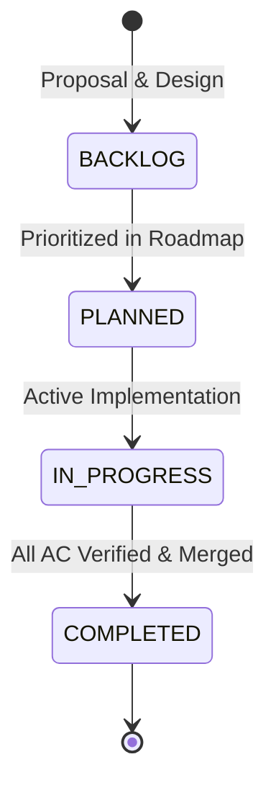

# Phase Documentation Architecture & Conventions

All feature initiatives, major milestones, and architectural expansions in `tradingview-streamer` are governed by modular, numbered phase documents stored in this directory (`docs/phases/`).

## 1. Numbering & File Naming Conventions
- Format: `docs/phases/<NNN>_<snake_case_title>.md`
- 3-digit zero-padded numbering (`001_` through `999_`) guarantees natural lexicographical sorting across all file managers and command-line tools.
- Every phase file MUST have:
  1. **Phase Header**: ID, Title, Status (`COMPLETED`, `IN_PROGRESS`, `PLANNED`, `BACKLOG`), Milestone target.
  2. **Objective & Problem Statement**: Why this phase exists and what exact issue/gap it addresses.
  3. **Deliverables & Modules Table**: Target files and responsibilities.
  4. **Acceptance Criteria**: Verifiable checkboxes (`AC-01`, `AC-02`, etc.).
  5. **Verification Command**: Deterministic command to prove completion.

## 2. Phase Lifecycle & State Machine

## 3. Comprehensive Master Index of Phases

| Phase | Title | Milestone | Status | Upstream Source / Capability |
|:---:|:---|:---:|:---:|:---|
| [001](001_core_streamer_and_extended_hours.md) | Core WebSocket Engine & Extended Trading Hours (ETH) | `v0.1.0` | `COMPLETED` | `mnwato/tradingview-scraper#63` (ETH support) |
| [002](002_technical_indicators_and_studies.md) | Technical Indicators & Built-in Studies Ingestion | `v0.2.0` | `COMPLETED` | `streamer.py` (`create_study` WebSocket RPC) |
| [003](003_deep_historical_backfill_and_paging.md) | Deep Historical Backfill & Timescale Paging | `v0.3.0` | `COMPLETED` | `streamer.py` (`request_more_data` backfill) |
| [004](004_multi_symbol_multiplexing_and_pool.md) | Multi-Symbol Multiplexing & Connection Pooling | `v0.4.0` | `COMPLETED` | High-concurrency socket pooling |
| [005](005_simd_json_and_polars_arrow_export.md) | Zero-Copy Columnar Ingestion & Analytical Export | `v0.5.0` | `COMPLETED` | Structure-of-Arrays columnar format & export |
| [006](006_resilient_supervisor_and_proxy_mesh.md) | Resilient Supervisor, Circuit Breaker & Proxy Rotation | `v0.6.0` | `COMPLETED` | `RISK-01` Proxy mesh & auto-healing |
| [007](007_python_pyo3_and_c_ffi_bindings.md) | C-ABI Foreign Function Interface & Multi-Language Bindings | `v0.7.0` | `COMPLETED` | Native C-ABI exports for C/C++, Python & Go |
| [008](008_quote_session_and_ticker_tape.md) | Real-Time Quote Session & Level 1 Ticker Tape Streamer | `v0.8.0` | `COMPLETED` | `price.py` (`quote_create_session`, `lp`, `chp`, `rtc`) |
| [009](009_scanner_and_screener_engine.md) | Financial Scanner & Multi-Market Screener Engine | `v0.9.0` | `COMPLETED` | `screener.py` (19 markets, rich filter expressions) |
| [010](010_market_movers_and_extended_hours_leaders.md) | Market Movers & Extended Hours Leaders (ETH) | `v0.10.0` | `COMPLETED` | `market_movers.py` (Pre/Post-market gainers/losers) |
| [011](011_technical_summary_and_indicator_matrix.md) | Technical Summary Ratings & Indicator Matrix | `v0.11.0` | `COMPLETED` | `technicals.py` (`Recommend.All`, 80+ indicator fields) |
| [012](012_symbol_fundamentals_and_financials.md) | Symbol Fundamentals, Valuation Multiples & Financial Statements | `v0.12.0` | `COMPLETED` | `overview.py`, `fundamental_graphs.py` |
| [013](013_multi_exchange_discovery_and_arbitrage.md) | Multi-Exchange Instrument Resolution & Global Arbitrage Discovery | `v0.13.0` | `COMPLETED` | `symbol_markets.py`, `markets.py` |
| [014](014_corporate_and_economic_calendars.md) | Corporate Calendars (Earnings, Dividends & Macro Events) | `v0.14.0` | `COMPLETED` | `cal.py` (Earnings surprise, dividend yields) |
| [015](015_market_news_and_intelligence.md) | Real-Time Market News & Editorial Intelligence Feed | `v0.15.0` | `COMPLETED` | `news.py` (Headlines, wire stories, tickers) |
| [016](016_trader_sentiment_and_ideas.md) | Community Trader Sentiment, Ideas & Micro-Posts | `v0.16.0` | `COMPLETED` | `ideas.py`, `minds.py` (Crowd sentiment & setups) |
| [017](017_dynamic_venue_disambiguation_and_strict_resolution.md) | Dynamic Venue Disambiguation & Strict Exchange Resolution | `v0.17.0` | `COMPLETED` | `CON-08` & `ADR-04` Anti-Hardcode Venue Disambiguation |
| [018](018_total_return_and_date_range_ingestion.md) | Total Return Dividend Adjustment & Date-Range Ingestion | `v0.18.0` | `COMPLETED` | `yfinance` parity: `PriceAdjustment` (`auto_adjust`) & `DateRange` |
| [019](019_multi_ticker_batch_download_and_portfolio.md) | Multi-Ticker Batch Download & Columnar Portfolio | `v0.19.0` | `PLANNED` | `yf.download(["AAPL", "MSFT"])` batch ingestion & matrix |
| [020](020_watchlist_baskets_and_corporate_actions.md) | Curated Watchlist Baskets & Corporate Actions History | `v0.20.0` | `PLANNED` | `Watchlist::mag7()`, historical dividends, splits, actions |
