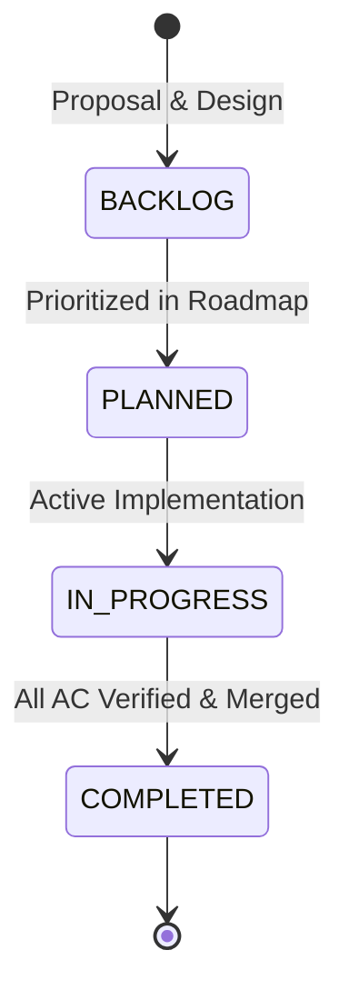

# Phase Documentation Architecture & Conventions

All feature initiatives, major milestones, and architectural expansions in `tradingview-streamer` are governed by modular, numbered phase documents stored in this directory (`docs/phases/`).

## 1. Numbering & File Naming Conventions
- Format: `docs/phases/<NNN>_<snake_case_title>.md`
- 3-digit zero-padded numbering (`001_` through `999_`) guarantees natural lexicographical sorting across all file managers and command-line tools.
- Every phase file MUST have:
  1. **Phase Header**: ID, Title, Status (`COMPLETED`, `IN_PROGRESS`, `PLANNED`, `BACKLOG`), Milestone target.
  2. **Objective & Problem Statement**: Why this phase exists and what exact issue/gap it addresses.
  3. **Deliverables & Modules Table**: Target files and responsibilities.
  4. **Acceptance Criteria**: Verifiable checkboxes (`AC-01`, `AC-02`, etc.).
  5. **Verification Command**: Deterministic command to prove completion.

## 2. Phase Lifecycle & State Machine

## 3. Index of Phases

| Phase | Title | Milestone | Status |
|:---:|:---|:---:|:---:|
| [001](001_core_streamer_and_extended_hours.md) | Core WebSocket Engine & Extended Trading Hours (ETH) | `v0.1.0` | `COMPLETED` |
| [002](002_technical_indicators_and_studies.md) | Technical Indicators & Built-in Studies Ingestion | `v0.2.0` | `PLANNED` |
| [003](003_deep_historical_backfill_and_paging.md) | Deep Historical Backfill & Timescale Paging | `v0.3.0` | `PLANNED` |
| [004](004_multi_symbol_multiplexing_and_pool.md) | Multi-Symbol Multiplexing & Connection Pooling | `v0.4.0` | `BACKLOG` |
| [005](005_simd_json_and_polars_arrow_export.md) | Zero-Copy SIMD Deserialization & Polars/Arrow Integration | `v0.5.0` | `BACKLOG` |
| [006](006_resilient_supervisor_and_proxy_mesh.md) | Resilient Supervisor, Circuit Breaker & Proxy Rotation | `v0.6.0` | `BACKLOG` |
| [007](007_python_pyo3_and_c_ffi_bindings.md) | Python (PyO3) & C-ABI Foreign Function Interface | `v0.7.0` | `BACKLOG` |
